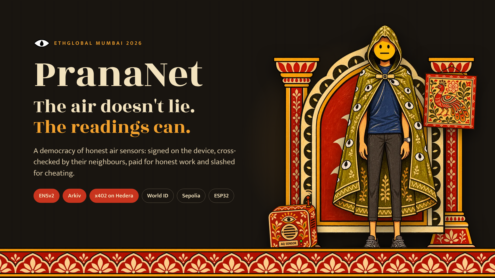
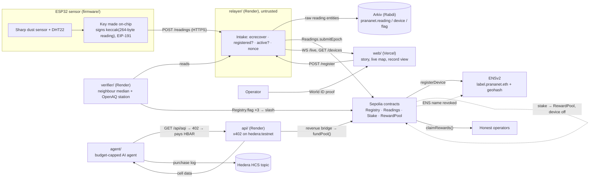

<p align="center">
  
</p>

<h3 align="center">The air doesn't lie. The readings can.</h3>

<p align="center">
  <a href="https://prananet.hemeshkanyal.com"></a>
  <a href="https://prananet.hemeshkanyal.com/live"></a>
  <a href="#demo-video"></a>
  <a href="https://prananet.hemeshkanyal.com/run-a-node"></a>
</p>

<p align="center">
  Built at <b>ETHGlobal Mumbai 2026</b> (Building from Scratch) · ENSv2 · World ID · Arkiv · x402 on Hedera · Sepolia · ESP32
</p>

---

**PranaNet** is air-quality data that holds up in a dispute. ESP32 sensors sign every reading on the device. Neighbours and official stations cross-check it. Cheaters lose their stake, and honest operators get paid.

Full spec: [docs/SPEC.md](docs/SPEC.md) · team interfaces: [docs/TEAM.md](docs/TEAM.md) · final status: [docs/STATUS.md](docs/STATUS.md) · roadmap to a real network: [docs/ROADMAP.md](docs/ROADMAP.md).

## The problem

Air-quality numbers are easy to fake when whoever is being measured also owns the meter.

Officials stuffed cotton into Xi'an's monitors and seven were jailed ([Caixin](https://www.caixinglobal.com/2018-01-29/court-papers-reveal-how-officials-faked-xian-air-pollution-readings-101204613.html)). Hunan sprayed mist cannons near stations during smog ([Caixin](https://www.caixinglobal.com/2018-02-02/what-bad-air-hunan-officials-use-mist-cannons-to-fool-pollution-meters-101206784.html)). In Delhi in 2025, reporters questioned water sprinkling around monitors and 163 hours of missing Diwali data ([Newslaundry](https://www.newslaundry.com/2025/10/27/ground-still-wet-air-stays-toxic-a-reality-check-at-anand-vihar-air-monitor-after-water-sprinkler-video), [The Star](https://www.thestar.com.my/aseanplus/aseanplus-news/2025/12/02/indias-capital-accused-of-tampering-with-air-quality-readings-to-make-pollution-look-less-dire)). India's Supreme Court asked the Delhi government to explain its monitoring equipment ([The Leaflet](https://theleaflet.in/amp/story/leaflet-reports/supreme-court-asks-delhi-government-to-detail-aqi-monitoring-equipment-and-its-accuracy)).

It doesn't matter who holds power: the people being measured shouldn't be the only ones holding the meter.

## How it works



Every reading is signed at the source, so the relayer can't change it; it only pays gas. A device that strays more than 50% **and** more than 25 µg/m³ from its neighbourhood median gets flagged. Three flags in a row slash its stake into the reward pool and revoke its ENS name.

## What each partner does

| Partner | What it does in PranaNet | Proof |
|---|---|---|
| **ENS (v2, Sepolia)** | Each device is `label.prananet.eth` with a geohash record: a readable identity that is revoked when the device is slashed. | [M3 evidence](docs/evidence/m3-worldid-ens.md) · [DeviceNamer](https://sepolia.etherscan.io/address/0xC53836B17b85c6329976e673c1385dbB590794fA#code) |
| **World ID** | Operators prove they're unique humans. One nullifier, at most 3 devices, so nobody can fake a crowd. | [M3 evidence](docs/evidence/m3-worldid-ens.md) |
| **Arkiv** | Every raw reading and flag is an open, queryable entity, filtered to the relayer's writer wallet. Anyone can audit without our server. | [Writer wallet on Arkiv](https://rabdi.explorer.arkiv.network/address/0x3a1F21F1c6f05eFA35BB7178274b41C8873CCa67) · [schema](arkiv/schema.md) |
| **Hedera (x402)** | AI agents pay per request in HBAR for cross-checked cell data; the revenue funds the reward pool. | [Settled payment](https://hashscan.io/testnet/transaction/0.0.9185802@1793964343.612274191) · [M5 evidence](docs/evidence/m5-x402-hedera.md) |
| **Sepolia** | `Readings` re-checks every signature and nonce; `Registry` stakes, flags, slashes and pays honest operators. | [M4 slash + claims](docs/evidence/m4-slash.md) · [Registry](https://sepolia.etherscan.io/address/0x729aec8cAA594804BD66cF4B21d113dF9DBD9Cae#code) |

## Live proof

Sepolia, Arkiv Rabdi, Hedera testnet and Render, all live:

| What | Link |
|---|---|
| Website (story + live dashboard) | https://prananet.hemeshkanyal.com (story) · [/live](https://prananet.hemeshkanyal.com/live) · [/roadmap](https://prananet.hemeshkanyal.com/roadmap) |
| Relayer (stable URL) | https://prananet-relayer.onrender.com (`/health`, `/devices`, `wss://…/live`) |
| Verifier | https://prananet-verifier.onrender.com/cells/te7u6n |
| Paid data API (x402) | https://prananet-api.onrender.com/api/aqi?geohash=te7u6n · discovery `/.well-known/x402` |
| Registry | [0x729aec8c…9Cae](https://sepolia.etherscan.io/address/0x729aec8cAA594804BD66cF4B21d113dF9DBD9Cae#code) (verified) |
| Readings | [0x9192Fc05…01d8](https://sepolia.etherscan.io/address/0x9192Fc053e1493EB2B7355192aa3F8e57AAE01d8#code) (verified) |
| Stake | [0x838736B3…E8E2](https://sepolia.etherscan.io/address/0x838736B31aA2D67e32055A9b3C835e550d05E8E2#code) (verified) |
| RewardPool | [0x61EEB7a5…D901](https://sepolia.etherscan.io/address/0x61EEB7a5fadD850D4986f4656d4a28CfE59Ed901#code) (verified) |
| DeviceNamer (ENSv2) | [0xC53836B1…94fA](https://sepolia.etherscan.io/address/0xC53836B17b85c6329976e673c1385dbB590794fA#code) (verified) |
| prananet.eth | [register tx](https://sepolia.etherscan.io/tx/0x1e1df385c7d64a5837626a9855d701d1cf4ba8c16869afb146cebd9e0f14213e) · subname registry [0xb6C47798…8b63](https://sepolia.etherscan.io/address/0xb6C4779845D6d0875DC6F7BCF7C656990D1A8b63) · resolver [0x5d05e294…9dF3](https://sepolia.etherscan.io/address/0x5d05e294e7bee7CC8c86d05732CEB2FCE8789dF3) |
| **Arkiv writer wallet** (= relayer, also the Sepolia tx sender) | [0x3a1F21F1…CCa67 on Arkiv](https://rabdi.explorer.arkiv.network/address/0x3a1F21F1c6f05eFA35BB7178274b41C8873CCa67) · [on Sepolia](https://sepolia.etherscan.io/address/0x3a1F21F1c6f05eFA35BB7178274b41C8873CCa67) |
| Devices | `bkc-01.prananet.eth` (device 1, DHT22) · `bkc-02.prananet.eth` (device 2, **slashed** in M4) → re-registered as `bkc-02b`, then `bkc-02c.prananet.eth` · cell `te7u6n` (Jio World Centre, BKC) |
| Hedera | API revenue [0.0.11336714](https://hashscan.io/testnet/account/0.0.11336714) · agent [0.0.11338297](https://hashscan.io/testnet/account/0.0.11338297) · HCS purchase log [topic 0.0.11338299](https://hashscan.io/testnet/topic/0.0.11338299) |
| Settled x402 payment (Hedera tx id) | [`0.0.9185802@1793964343.612274191`](https://hashscan.io/testnet/transaction/0.0.9185802@1793964343.612274191) |
| Revenue → pool | [fundPool on Sepolia](https://sepolia.etherscan.io/tx/0xf07a43f1c284ebaa4253857e877270553aca1bdcbfc41003b1f0e20f4818ba26) |

**Milestone evidence:**
- [M1 device signing](docs/evidence/device2-selftest.md)
- [classic boards selftest](docs/evidence/classic-boards-selftest.md)
- [M3 World ID + ENS](docs/evidence/m3-worldid-ens.md)
- [M4 slash + claims](docs/evidence/m4-slash.md)
- [M5 x402 on Hedera](docs/evidence/m5-x402-hedera.md)

The first M1 run used the v1 contracts in `contracts/deployments/sepolia-v1.json` ([ReadingAccepted](https://sepolia.etherscan.io/tx/0xc8148daac8a630c55c8257220ec33b55f3b5172bc8295a80266a487db39b5c94), [forged reading reverted](https://sepolia.etherscan.io/tx/0x258afb1976c2169dedd227210b74024dc3cb7d1a21c3968141592cd432088c50)).

### Query Arkiv yourself (no PranaNet server involved)

```bash
cd relayer && npm ci && npx tsx scripts/arkiv-query.ts te7u6n 10
```

This returns the latest readings in the venue cell, written by `0x3a1F…CCa67` only, with each record's signature and explorer link, plus the latest flags.

More on Arkiv: [schema](arkiv/schema.md) · [why Arkiv](arkiv/why-arkiv.md) · [how we use it](arkiv/how-you-use-arkiv.md) · [reach](arkiv/reach.md) · [friction log](arkiv/friction.md).

### Payment flow (x402 on Hedera → reward pool)

1. **Discover and ask.** The agent reads `GET /.well-known/x402`, then calls `GET /api/aqi?geohash=te7u6n`. It gets a **402** with `PAYMENT-REQUIRED`:
   - scheme `exact`, network `hedera:testnet`, asset `0.0.0` (HBAR)
   - amount 10,000,000 tinybar (0.1 HBAR), `payTo` 0.0.11336714
   - `feePayer` 0.0.9185802 (the x402.org facilitator)
2. **Pay within budget.** The agent's budget hook checks the price against a per-call cap and a hard total cap for the run. Then `@x402/fetch` signs a Hedera transfer and retries with `PAYMENT-SIGNATURE`. No human approves anything.
3. **Settle.** The facilitator verifies and settles on Hedera. The API returns the verifier's cell object with `PAYMENT-RESPONSE`, the Hedera transaction id (a HashScan link).
4. **Log.** The agent appends `{resource, geohash, pm25, amount, tx}` to the HCS topic.
5. **Bridge revenue.** `cd api && npm run bridge`:
   - lists every x402 settlement into `PAY_TO` from the Hedera mirror node; only transactions submitted by the facilitator count;
   - converts at a fixed, published testnet rate (1 HBAR = 0.0001 Sepolia ETH);
   - calls `RewardPool.fundPool()` once per batch.

   It's an operator relay (no trustless testnet bridge exists), but every input can be re-checked on the mirror node and every batch is recorded.
6. **Claim.** Honest operators call `RewardPool.claimRewards(device)`: 0.00001 ETH per accepted, unflagged epoch. A slashed device can't claim (`DeviceNotActive`), and its stake is already in the pool.

## Run it yourself

**Prerequisites:**
- Node 24
- Foundry (`~/.foundry/bin/forge` 1.8+)
- arduino-cli with the ESP32 core 3.3.12
- Python 3 + pyserial
- Docker (optional)

Every service has a `.env.example` listing each variable; copy it to `.env` (never committed).

<details>
<summary><b>Contracts</b> (<code>contracts/</code>)</summary>

```bash
forge test                            # 51 tests incl. fork tests against live ENSv2 (set SEPOLIA_RPC_URL)
./deploy.sh                           # deploy + verify on Etherscan, writes deployments/sepolia.json, exports abi/
./script/ens-setup.sh                 # register prananet.eth (MockUSDC), subname registry + resolver
```

Sepolia now charges ~7× forge's simulated gas for contract creation, so `deploy.sh` applies `GAS_ESTIMATE_MULTIPLIER` (900).
</details>

<details>
<summary><b>Firmware</b> (<code>firmware/prananet/</code>)</summary>

Both boards are classic ESP32 DevKit 30-pin (`esp32:esp32:esp32`):
- D25 = Sharp LED
- D34 = Vo via a 10k/22k divider
- device 1 adds a DHT22 on D4

```bash
cp secrets.example.h secrets.h        # Wi-Fi, RELAYER_URL, READINGS_ADDRESS, labels/geohash
arduino-cli compile --fqbn esp32:esp32:esp32 --build-property "compiler.cpp.extra_flags=-DDEVICE=1" .
arduino-cli upload  --fqbn esp32:esp32:esp32 -p $(python3 ../tools/serial_cmd.py --find 1) .
```

Serial commands:
- `addr`
- `selftest` (check it with `cd relayer && npm run verify-vector -- - < log`)
- `status`
- `cal <µg/m³>`: one-point calibration against the nearest reference station
- `newkey`: a fresh key for re-registering after a slash

Ports can swap between the two CP2102 boards: always identify a board by `addr`.
</details>

<details>
<summary><b>Relayer</b> (<code>relayer/</code>)</summary>

`npm ci && npm test && npm start` (:8080). Details, tunnel and Docker: [relayer/README.md](relayer/README.md).
</details>

<details>
<summary><b>Verifier</b> (<code>verifier/</code>)</summary>

`npm ci && npm test && npm start` (:8081). It needs:
- `RELAYER_URL`
- `SIM_TOKEN` (the same as the relayer's)
- `OPENAQ_API_KEY`
- `VERIFIER_PRIVATE_KEY` (holds the Registry verifier role)
</details>

<details>
<summary><b>Paid API</b> (<code>api/</code>)</summary>

`npm ci && npm test && npm start` (:8082). Set `PAY_TO` (a Hedera account) and `VERIFIER_URL`. `npm run bridge` needs `TREASURY_PRIVATE_KEY`.
</details>

<details>
<summary><b>Agent</b> (<code>agent/</code>)</summary>

Run `npm ci && npm run setup` once. It creates the agent account and HCS topic from `HEDERA_OPERATOR_ID/KEY` and sets the API's `PAY_TO`.

Then `npm start -- --times 2`. Caps: `BUDGET_TINYBAR`, `MAX_PER_CALL_TINYBAR`.
</details>

<details>
<summary><b>Web</b> (<code>web/</code>, Arpan)</summary>

`npm ci && npm run dev`. The env is in `web/.env.example`:
- `NEXT_PUBLIC_RELAYER_URL=https://prananet-relayer.onrender.com`
- contract addresses
- World ID app/RP

Deployed on Vercel with root directory `web/`.
</details>

<details>
<summary><b>Hosting</b></summary>

The relayer, verifier and api run on Render from their Dockerfiles (`docker build -f <svc>/Dockerfile .` from the repo root). The relayer pings the other two every 5 min (`KEEPALIVE_URLS`).
</details>

<details>
<summary><b>Repository layout</b></summary>

```
contracts/   Foundry: Registry, Readings, Stake, RewardPool, DeviceNamer (ENSv2); deploy + ENS scripts
firmware/    ESP32 (Arduino), one sketch with a DEVICE switch; tools/serial_cmd.py
relayer/     Node + TypeScript: intake, Arkiv writes, Sepolia tx queue, chain index, WS, World ID register
verifier/    cross-check job, simulated neighbours, OpenAQ, Registry.flag/clearFlags, GET /cells/:geohash
api/         x402 data API on hedera:testnet + revenue bridge to RewardPool
agent/       autonomous paying agent with a budget cap and HCS purchase log
web/         Next.js site: story, live map, device pages, Arkiv record view, register flow (Arpan)
arkiv/       schema, write-ups, friction log
docs/        SPEC, TEAM, STATUS, ROADMAP, DEBRIEFS, AI usage logs, prompts, evidence, screenshots
```
</details>

## Demo script (≈4 min)

<a id="demo-video"></a>**Demo video:** _link coming soon_

> **Keep the sensor clear whenever a board resets.** That means plugging it in, flashing, opening the serial port (which resets a classic ESP32), and `demo-reset`.
>
> The board measures its clean-air baseline for the first 10 s after boot, so remove any tissue and wait for smoke or incense to clear first. Since prompt 04 the baseline can only move down and readings never go below it (no false zeros), but a dirty boot still under-reports until the air clears.

1. **Map** (web → `/live`): two real devices at the venue cell `te7u6n` next to 5 clearly labelled simulated neighbours. The cell value ≈ the BKC reference station (OpenAQ, 0.5 km).
2. **Signed data:** open `bkc-01.prananet.eth` → live chart. Open a record → "raw data on Arkiv": the entity, writer wallet, expiry, the query, and the signature re-verified in the browser. Then show `npx tsx scripts/arkiv-query.ts te7u6n` returning the same data from Arkiv directly.
3. **Forged reading:** `npm run fake-reading -- --device <addr> --relayer https://prananet-relayer.onrender.com` → relayer 401 and an on-chain `InvalidSignature` revert.
4. **Register with World ID:** `/register` → Verify with World ID → simulator → `bkc-0Nx.prananet.eth` minted with its geohash. A 4th device from the same human → "already has 3 devices".
5. **Cheat and get slashed:** tissue or incense on device 2 → 3 neighbour-outlier flags appear live (WS) → `DeviceSlashed`: the stake goes to the pool, status becomes `slashed`, and the ENS name is cleared (`prananet.status = slashed`).
6. **Agent pays:** `cd agent && npm start` → 402 → pays 0.1 HBAR → data + HashScan link → HCS message.
7. **Money flows to the honest:** `cd api && npm run bridge` → `fundPool`. `claimRewards(bkc-01)` pays; `claimRewards(bkc-02)` reverts `DeviceNotActive`.
8. **Reset for the next take** (sensor clear, see above): `cd relayer && npm run demo-reset` gives the board a new key, the next label, another simulator human, and a stake. Run `npm run demo-reset -- --warm` once well before.

## Reused vs new

**Reused (before the event):**
- **Hardware:** both sensor devices (ESP32 DevKit boards, Sharp GP2Y1014AU0F dust sensors with 10k/22k dividers, one DHT22) were assembled and tested before hacking started. No firmware or software was carried over. (Device 2 was originally an ESP32-S3; it was swapped for a second DevKit during the event.)

**Libraries, SDKs and services:**
- **Contracts:** [Foundry](https://getfoundry.sh) + forge-std 1.17.0; ENSv2 contracts on Sepolia (called, not copied: the ABIs come from the verified sources)
- **Firmware:** Arduino-ESP32 core 3.3.12 and its bundled **mbedTLS 3.6** (secp256k1, RFC 6979 deterministic ECDSA, hardware MPI); Adafruit DHT sensor library 1.4.7. Keccak-256, recovery-id computation, low-s normalisation and the 264-byte packing are new.
- **Node:** viem 2.57.13, @arkiv-network/sdk 1.0.1, ws 8.22.0, ngeohash, @x402/core, express, fetch, hedera 2.30.0, express 5.3.0, @hiero-ledger/sdk 2.90.1, playwright-core 1.65.0 (demo reset only), tsx, vitest
- **Web (Arpan):** Next.js 15, @worldcoin/idkit 4.6, Leaflet / react-leaflet
- **Services:** World ID Developer Portal + simulator, x402.org facilitator, OpenAQ v3, Alchemy (Sepolia RPC), Arkiv hub (access key, faucet), Render, Vercel, Cloudflare quick tunnel (early testing)
- The verifier, api and agent scaffolds were started by Siddhartha and finished by Hemesh (see the AI usage logs).

**New (written during the event):** everything else in this repo.

## AI use

Claude Code wrote most of the code under our direction. Every prompt is saved verbatim in [docs/prompts/](docs/prompts/), and each person's per-task log is in [docs/AI-USAGE.md](docs/AI-USAGE.md) → `docs/ai-usage/<name>.md`.

The story site's illustrations are Arpan's scene paintings plus a hand-painted asset kit made with ChatGPT image generation (logged in [docs/ai-usage/hemesh.md](docs/ai-usage/hemesh.md)). Sponsor debriefs: [docs/DEBRIEFS.md](docs/DEBRIEFS.md).

## Honest limitations

- **The sensor is a PM proxy.** The Sharp GP2Y1014AU0F is a low-cost dust sensor with a one-point calibration against the nearest official station. The AQI we show is indicative.
- **Simulated neighbours.** Five of the seven nodes in the venue cell are simulated, so the cross-check has something to compare against. They are labelled everywhere: map, tables, Arkiv (`simulated = true`).
- **The ESP32 key can be extracted.** The device key sits in flash, and anyone with physical access can read it. Production stations need a secure element and secure boot ([roadmap](docs/ROADMAP.md)).
- **An operator bridge.** HBAR revenue reaches the Sepolia reward pool through an operator-run relay at a fixed testnet rate. Every input can be re-checked on the Hedera mirror node, but the bridge itself isn't trustless.

What we'd build next to make this a real network is in [docs/ROADMAP.md](docs/ROADMAP.md).

## Team

| | Built |
|---|---|
| **Hemesh** ([HemeshKanyal](https://github.com/HemeshKanyal)) | Firmware, contracts, relayer, Arkiv; then the verifier, x402 API and paying agent; the story site redesign |
| **Arpan** ([arpan2006hub](https://github.com/arpan2006hub)) | Web: dashboard, device pages, register flow with World ID, the folk-art scene paintings |
| **Siddhartha** ([siddhartha7419](https://github.com/siddhartha7419)) | First verifier, API and agent scaffolds |

## License

MIT, see [LICENSE](LICENSE).
